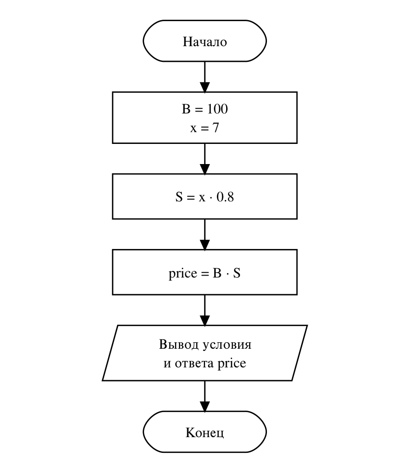

# Домашнее задание к работе №2
Вариант 10

## Условие задачи
В магазине продается костюмная ткань. Ее цена B рублей за кв. метр. Напишите программу, которая подсчитает и выведет на экран стоимость куска этой ткани длиной x м и шириной 80 см.

## 1. Алгоритм и блок-схема
### Алгоритм:
1. Начало.
2. Задать переменные:
- **B** — цена ткани за квадратный метр (100 рублей);
- **x** — длина куска ткани (7 м).
3. Вычислить площадь куска **S = x · 0.8** (ширина 80 см = 0.8 м).
4. Вычислить стоимость **price = B · S**.
5. Вывести условие задачи с подставленными значениями и ответ.
6. Конец.

### Блок-схема:


## 2. Реализация программы
```c
#include <stdio.h>
#include <locale.h>


int main() {
    setlocale(LC_CTYPE, "RUS");
    int B = 100;
    int x = 7;
    float S = x * 0.8; // площадь куска: длина x на ширину 0.8 м (80 см)
    float price = B * S; // цена за квадратный метр, умноженная на площадь
    printf("В магазине продается костюмная ткань. Ее цена %d рублей за кв. Метр.\nНапишите программу, которая подсчитает и выведет на экран стоимость куска\nэтой ткани длиной %d м и шириной 80 см.\nОтвет: %.2f рублей", B, x, price);
    return 0;
}
```

## 3. Результаты работы программы
Вывод программы:
```
В магазине продается костюмная ткань. Ее цена 100 рублей за кв. Метр.
Напишите программу, которая подсчитает и выведет на экран стоимость куска
этой ткани длиной 7 м и шириной 80 см.
Ответ: 560.00 рублей
```

## 4. Информация о разработчике
Файко Андрей Юрьевич, бТИИ-262
